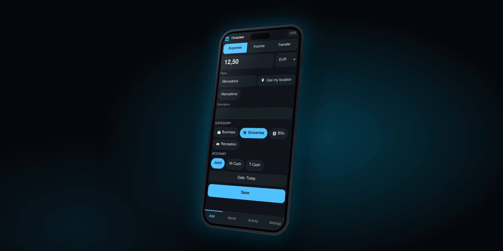

<p align="center"></p>

<p align="center"></p>

# fitracker

A fast, installable, offline-first phone app for the yearly budget sheet you already keep in
Google Sheets. Add an expense in a few taps, see budget vs actual for the month, and keep using
the sheet itself: **the sheet is the only database**. There is no server of ours; the app talks to
the Google Sheets API straight from your browser.

- **Quick entry.** Amount, one tap on a suggested place, Save. Date defaults to today and the
  currency to the last one you used. Place and description suggest from your own history.
- **Any of EUR, GBP, USD per entry.** Amounts are stored as entered; the sheet converts to your
  base currency with live rates for its own summaries.
- **Offline first.** Changes are queued on the device and replayed in order when you are back
  online. A change to a row that no longer exists is set aside for you, never silently retried.
- **Undo.** Deletes and edits keep the previous values so you can undo them from Activity.
- **Your sheets, your years.** Link one sheet per year, for any year. A versioned migration brings
  older sheets to the current layout, with backup tabs first.
- **Shared by whoever has the sheet.** Each person signs in with their own Google account.

## Run it

```bash
pnpm install
cp .env.example .env     # fill in the Google values, see docs/deploy-your-own.md
pnpm dev
```

| Command | What it does |
| --- | --- |
| `pnpm dev` / `pnpm build` / `pnpm preview` | develop, build, preview the production bundle |
| `pnpm typecheck` / `pnpm lint` / `pnpm test` | types, lint, unit tests |
| `pnpm exec playwright test` | end-to-end tests against an in-memory sheet (no Google needed) |

## Docs

- [Deploy your own copy](docs/deploy-your-own.md): Google Cloud setup and hosting.
- [The sheet template](docs/template.md): what the app expects, and how migration works.
- [Month view rules](docs/month-rules.md) and [known corner cases](docs/corner-cases.md).
- Design: [spec](docs/designs/specs/2026-11-10-fitracker-design.md), [plan](docs/designs/plans/2026-11-10-fitracker-v1.md).

## License

MIT, see [LICENSE](LICENSE).
